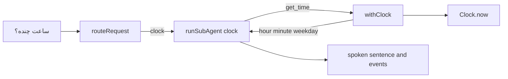

# Design Document

## Overview

The clock ability answers "ساعت چنده؟" with the current time and weekday in one short spoken sentence. It follows `.kiro/steering/extensions.md`, as the settings ability did.

- A sub-agent `clock` with one tool, `get_time`.
- A wrapper `withClock(tools, clock)` that replaces the stub `get_time` with an executor reading an injected `Clock`.
- A replay fixture for the exact Farsi request, so it works with no `OPENROUTER_API_KEY`.
- No new `AssistantEvent` type and no new surface. Existing `agent`, `tool_call` (`started`, `succeeded`, `failed`), `speech`, and `caption` events carry everything.

Decisions: the tool returns data, not a sentence, so the model phrases it in the user's language. Failure is `ok: true` with `applied: false` and a spoken reason. Weekday names are tokens for the model, not user-facing text. The system `Clock` is built only in `app.ts`. Server local time zone is used.

## Architecture



Composition in `app.ts`. `withClock` is outermost and replaces only `get_time`, so settings and contact behavior is unchanged:

```ts
const clock: Clock = { now: () => new Date() };
tools: withClock(
  withSettings(withContactResolution(createStubTools().tools, fixtureContacts), hub),
  clock,
),
```

Dependencies: `packages/contracts` gains names only. Agents never import `clock/`. The new cross-module dependency is `clock/withClock.ts` to `packages/strings`.

## Components and Interfaces

### Contracts (`packages/contracts/src`)

- `tools.ts`: append `"get_time"` to `toolNames`. Add `get_time: Record<string, unknown>` to `ToolInputs`, like `reset_settings`, so extra fields type-check and are ignored.
- `events.ts`: append `"clock"` to `agentNames`. `AssistantEvent` is untouched.

### Orchestrator (`apps/server/src/orchestrator`)

- `agents.ts`: add to `agentDefinitions` (the router enum derives from it):

```ts
clock: {
  system:
    "You tell an elderly user the current time and day. Call get_time first, and take the time and the day of the week only from its result. Then state both in one short sentence in the user's language, the language the user spoke. If the result has applied false, say in one short sentence in the user's language that the time is unavailable, and state no time or day.",
  tools: ["get_time"],
},
```

- `routeRequest.ts`: add the line `clock: questions about the current time or the current day of the week.` to `routerSystem`. Extend the closing clause so a time question mixed with a comms, home, media, or settings intent goes to `clarifier`, merged into the existing sentence so one such clause remains.
- `toolSchemas.ts`: `get_time` with description "Return the current time (hour and minute) and the current day of the week." and `inputSchema: { type: "object", properties: {} }`.
- `stubTools.test.ts`: add `get_time: {}`. `createStubTools` builds from `toolNames`, so no stub code.

### Clock module (`apps/server/src/clock`)

| File | Job |
|---|---|
| `clock.ts` | `interface Clock { now(): Date }` |
| `readMoment.ts` | `readMoment(clock): TimeResult \| undefined`. Reads once. Returns `undefined` on a throw or non-finite date |
| `withClock.ts` | `withClock(tools: ToolSet, clock: Clock): ToolSet`, same shape as `withSettings` |

```ts
export const weekdays = ["Sunday", "Monday", "Tuesday", "Wednesday", "Thursday", "Friday", "Saturday"] as const;
export type TimeResult = { hour: number; minute: number; weekday: (typeof weekdays)[number] };

async execute(): Promise<ToolResult> {
  const moment = readMoment(clock);
  if (moment === undefined) {
    return { ok: true, output: { applied: false, error: strings.clock.unavailable } };
  }
  return { ok: true, output: { applied: true, ...moment } };
}
```

`readMoment` uses `getHours()`, `getMinutes()`, and `weekdays[getDay()]`. The wrapper takes no event bus, so zero events are guaranteed by construction.

### Strings, fixture, web

- `packages/strings/src/strings.ts`: `clock: { unavailable: "The time is unavailable" }`, with a nonblank-keys test in `strings.test.ts`.
- `orchestrator/fixtures/clock.json`: transcript `ساعت چنده؟`, three responses in the `speakSlower.json` shape: `route_to_agent` `{ "agent": "clock" }`, `get_time` `{}`, then `end_turn` text. Register after `resetSettings` in `llm/replayConversations.ts`. The recorded text is fixed, so it is a neutral Farsi sentence and not a real time.
- Web: no planned change. `describeEvent.ts` switches on event type, so typecheck should hold. If not, apply the minimal fix from Requirement 7.6.

## Data Models

`output` is `{ applied: true, hour: 0-23, minute: 0-59, weekday }` or `{ applied: false, error: strings.clock.unavailable }`, both with `ok: true`.

## Correctness Properties

*A property is a characteristic or behavior that should hold true across all valid executions of a system-essentially, a formal statement about what the system should do. Properties serve as the bridge between human-readable specifications and machine-verifiable correctness guarantees.*

### Property 1: Tool name guard accepts only listed names

*For any* value, `isToolName` returns true exactly when the value is a string listed in `toolNames`, and never throws.

**Validates: Requirements 1.4, 1.5, 1.6**

### Property 2: get_time reports the local moment

*For any* valid moment from a Fake_Clock, `get_time` returns `ok: true` with `applied: true`, an integer hour 0 to 23, an integer minute 0 to 59, and a weekday from the seven names, equal to the local hour, minute, and weekday of that moment.

**Validates: Requirements 5.3, 5.4, 5.5, 5.6, 5.7**

### Property 3: get_time is idempotent

*For any* valid moment from a Fake_Clock, executing `get_time` twice returns equal results.

**Validates: Requirements 5.8**

### Property 4: get_time ignores input fields

*For any* input object and valid moment, `get_time` returns the same result as for an empty input.

**Validates: Requirements 5.9**

## Error Handling

| Condition | Behavior |
|---|---|
| Clock throws | `ok: true`, `applied: false`, `strings.clock.unavailable`. No rethrow. Next call works |
| Clock returns an invalid date | Same as a throw |
| Undeclared tool called | Existing unknown-tool error, no tool runs |
| Unmatched transcript offline | Existing "No recorded response" error |
| Time mixed with another ability | Router picks `clarifier` |

## Testing Strategy

Red/green TDD, one behavior per cycle. No paid API, real timers, or sockets. Properties use fast-check, at least 100 runs, one test each, tagged `Feature: clock, Property N: <title>`.

| Test file | Covers |
|---|---|
| `packages/contracts/src/isToolName.test.ts` | Exact lists, Property 1 |
| `orchestrator/agents.test.ts` | Entry, tools, "the user's language", no `/farsi/i`, prompt promises |
| `orchestrator/routeRequest.test.ts` | Enum, router line, mixed clause, route reaches clock |
| `orchestrator/toolSchemas.test.ts` | `get_time` schema |
| `orchestrator/stubTools.test.ts` | `get_time` sample input |
| `clock/withClock.test.ts` | Valid call, throw then recovery, invalid date, single read, zero events via `createRecordingEventBus`, other tools unchanged |
| `clock/withClock.property.test.ts` | Properties 2, 3, 4 |
| `clock/clockReplay.test.ts` | Real orchestrator with Fake_Clock: one `clock` agent event, `get_time` `started` then `succeeded`, fake hour, minute, weekday |
| `clock/clockApp.test.ts` | `createApp({})` with no key: `clock` agent event and `speech` on `/events` |
| `packages/strings/src/strings.test.ts` | `clock` keys nonblank |

Live-model wording is checked only in `npm run eval`.
