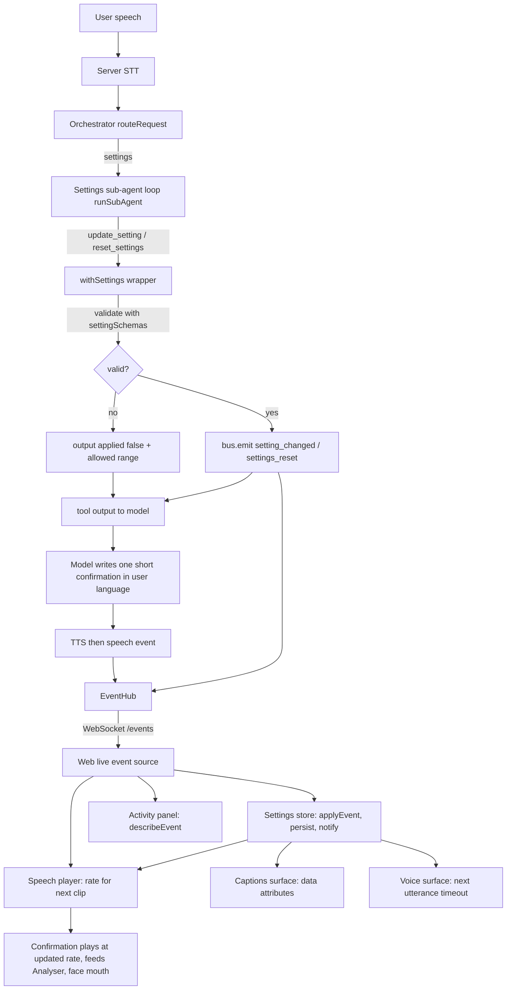

# Design Document

## Overview

The Settings agent changes yazd's own behavior by voice. Requirement numbers (Req N) refer to `requirements.md`. This document covers files and data flow only.

Key decisions:

- One registry, `settingSchemas`, in `packages/contracts` defines names, kinds, bounds, and defaults (Req 1). Everything else derives from it.
- The server holds no settings state (Req 14). Relative requests ("slower") are resolved by the model to absolute values. The prompt never assumes the current value.
- Settings tools are stubs in the base tool set. A wrapper in `apps/server/src/settings` replaces them with versions that validate and emit events on the hub, following `withContactResolution` (Req 13.5).
- Invalid updates return `{ ok: true, output: { applied: false, ... } }`. `runSubAgent` ends a run as failed on `{ ok: false }`, which would stop the model from speaking. Returning `ok: true` with `applied: false` lets the model speak one sentence with the allowed range (Req 3.6). No event is published in that case (Req 3.3 to 3.5, 5.4).
- Spoken confirmations are written by the model in the user's language (Req 5). The server hardcodes no confirmation text. Agent prompts are model instructions, not user-facing text, so they stay in `agents.ts` (Req 11.4).
- The web store subscribes to events itself in `main.ts`, so it tracks settings even when surfaces are turned off.
- Ordering: `setting_changed` is emitted during the tool call, before the `speech` event of the confirmation. The confirmation is therefore spoken at the new rate. This is intended (Req 9.1).
- Speech rate uses an `HTMLAudioElement` with `preservesPitch = true`. `createMediaElementSource` may be called once per element, so the player creates one element and one source node at construction and reuses them for every clip (Req 9.1, 9.9).

## Architecture



Dependency rules (structure.md): `packages/contracts` depends on nothing. `apps/web` and `apps/server` meet only through contracts, HTTP, and the WebSocket. Tools do not import agents. The new cross-module dependency is `apps/server/src/settings` importing `orchestrator` types (`ToolSet`, `EventBus`), the same direction as `contacts`.

## Components and Interfaces

### Files

Owners are from structure.md. "Wiring" means a minimal edit in Teammate 1's area (Req 16).

| File | New / Modified | Owner area | Change |
|---|---|---|---|
| `packages/contracts/src/settings.ts` | New | Sepehr | `settingSchemas`, `defaultSettings`, types |
| `packages/contracts/src/isSetting.ts` | New | Sepehr | `isSettingName`, `isSettingValue` |
| `packages/contracts/src/isSetting.test.ts` | New | Sepehr | Guard tests and properties |
| `packages/contracts/src/events.ts` | Modified | Sepehr | `agentNames` gains `settings`; two new events |
| `packages/contracts/src/isAssistantEvent.ts` (+ test) | Modified | Sepehr | Accept new events |
| `packages/contracts/src/tools.ts` (+ `isToolName.test.ts`) | Modified | Sepehr | Two tool names, `ToolInputs` entries |
| `packages/contracts/src/index.ts` | Modified | Sepehr | Re-exports |
| `packages/strings/src/strings.ts` | Modified | Sepehr (shared) | `settings` group |
| `apps/server/src/settings/withSettings.ts` | New | Sepehr (orchestrator area) | Wrapper replacing the two tools |
| `apps/server/src/settings/settingToolSchema.ts` | New | Sepehr | Per-setting JSON schema and tool description from registry |
| `apps/server/src/settings/withSettings.test.ts` | New | Sepehr | Wrapper tests and properties |
| `apps/server/src/orchestrator/agents.ts` (+ test) | Modified | Sepehr | `settings` definition and prompt |
| `apps/server/src/orchestrator/toolSchemas.ts` | Modified | Sepehr | Schemas for two tools |
| `apps/server/src/orchestrator/stubTools.ts` (+ test) | Modified | Sepehr | `sampleInputs` extended |
| `apps/server/src/orchestrator/routeRequest.ts` | Modified | Sepehr | Router description for settings |
| `apps/server/src/orchestrator/fixtures/speakSlower.json` | New | Sepehr | Farsi replay, Req 15.1, 15.3 |
| `apps/server/src/orchestrator/fixtures/resetSettings.json` | New | Sepehr | Farsi replay, Req 15.2, 15.4 |
| `apps/server/src/llm/replayConversations.ts` | Modified | Sepehr | Register both fixtures |
| `apps/server/src/app.ts` | Modified | Sepehr | `withSettings(withContactResolution(...), hub)` |
| `apps/server/src/settings/settingsReplay.test.ts` | New | Sepehr | Real orchestrator over fixtures, Req 15.6 |
| `apps/web/src/settings/applyEvent.ts` | New | Shared wiring | Pure reducer |
| `apps/web/src/settings/settingsStorage.ts` | New | Shared wiring | Load and save with try/catch |
| `apps/web/src/settings/settingsStore.ts` | New | Shared wiring | `createSettingsStore` |
| `apps/web/src/settings/*.test.ts` | New | Shared wiring | Reducer, storage, store tests |
| `apps/web/src/activity/describeEvent.ts` (+ test) | Modified | Shared wiring | Two new cases |
| `apps/web/src/surfaces/surface.ts` | Modified | Shared wiring | `settings` in `SurfaceContext` |
| `apps/web/src/testing/testContext.ts` | Modified | Shared wiring | Real store over in-memory storage |
| `apps/web/src/main.ts` | Modified | Shared wiring | Create store, pass to player and context |
| `apps/web/src/speech/speechPlayer.ts` (+ test) | Modified | Teammate 1, wiring | Audio element, `preservesPitch`, rate from store |
| `apps/web/src/captions/captionsSurface.ts` (+ test) | Modified | Teammate 1, wiring | Set `data-caption-size`, `data-contrast` on host |
| `apps/web/index.html` | Modified | Teammate 1, wiring | CSS for four sizes and two contrast modes |
| `apps/web/src/voice/voiceSurface.ts` (+ test) | Modified | Teammate 1, wiring | Snapshot timeout per utterance |
| `apps/web/src/voice/voiceConfig.ts` (+ test) | Modified | Teammate 1, wiring | Remove `silenceTimeoutMs` constant |

Other root change: `fast-check` 4.10.2 is already in root `devDependencies` (Req 12.1). The first task folds in the working-tree edits (`settings` in `agentNames`, one `isAssistantEvent` test) and re-runs them red then green.

`.kiro/specs/settings-agent/` holds this spec. Final summary lists every Teammate 1 file touched (Req 16.3). Planned splits keep every file under 150 lines.

### Contracts

```ts
export const settingSchemas = {
  speechRate: { kind: "number", min: 0.5, max: 1.5, default: 1.0 },
  captionSize: { kind: "enum", values: ["small", "medium", "large", "extra-large"], default: "large" },
  highContrast: { kind: "boolean", default: true },
  silenceWaitMs: { kind: "integer", min: 800, max: 4000, default: 1500 },
} as const;

export type SettingName = keyof typeof settingSchemas;
export type Settings = { speechRate: number; captionSize: CaptionSize; highContrast: boolean; silenceWaitMs: number };
export type SettingValue<N extends SettingName = SettingName> = Settings[N];
export const defaultSettings: Settings;

export function isSettingName(value: unknown): value is SettingName;
export function isSettingValue<N extends SettingName>(name: N, value: unknown): value is Settings[N];

export type SettingChangedEvent = {
  [N in SettingName]: { type: "setting_changed"; name: N; value: Settings[N] };
}[SettingName];
export type SettingsResetEvent = { type: "settings_reset" };
```

`isSettingValue` uses `Number.isFinite` and `Number.isInteger` for numeric kinds, so NaN and Infinity are rejected. `isSettingName` uses `Object.hasOwn`, so `"toString"` and `"__proto__"` are rejected. Tool contract:

```ts
export type ToolInputs = {
  update_setting: { name: SettingName; value: SettingValue };
  reset_settings: Record<string, unknown>;
};
```

### Server wrapper

```ts
export function withSettings(tools: ToolSet, bus: EventBus): ToolSet;

export type UpdateSettingOutput =
  | { applied: true; name: SettingName; value: SettingValue }
  | { applied: false; error: string; allowed: SettingAllowed };
```

`validateToolInput` takes one static schema and cannot express a value type that depends on `name`. The design uses two layers:

1. `toolSchemas.update_setting.inputSchema` is static: `name` is an `enum` built from `Object.keys(settingSchemas)`, `value` has no `type`, both required. `runSubAgent` runs this first (Req 3.2). The tool `description` is generated from the registry and lists the allowed values per name.
2. The wrapper calls `settingToolSchema(name)` to derive a per-setting schema from the registry, runs `validateToolInput` on `{ value }`, then `isSettingValue` as the final authority. `validateToolInput` already rejects NaN and Infinity when bounds exist, since the comparisons are false. The `isSettingValue` check also covers integer-ness and the boolean kind.

Unknown names that reach the wrapper (static layer bypassed in tests) return `applied: false` with an error naming the name (Req 3.3). Extra keys on `reset_settings` are ignored (Req 4.4). `reset_settings` always emits exactly one `settings_reset`.

### Router and agent

`agentDefinitions.settings` has tools `["update_setting", "reset_settings"]`. The prompt ends with the standard confirmation line, mentions no language by name, never assumes the current value, requires absolute values for relative requests, and tells the model to ask one question when the setting or value is missing (Req 5.3, 14). `routeRequest.ts` gains one description line. The router enum follows `agentDefinitions` automatically. Settings plus another intent routes to the clarifier by the existing router prompt, with an added sentence (Req 2.6, 2.7).

### Web store

```ts
export function applyEvent(state: Settings, event: AssistantEvent): Settings;
export function loadSettings(storage: Pick<Storage, "getItem">): Settings;
export function saveSettings(storage: Pick<Storage, "setItem">, state: Settings): boolean;

export type SettingsStore = {
  get(): Settings;
  subscribe(listener: (state: Settings) => void): () => void;
  dispose(): void;
};
export function createSettingsStore(deps: { events: EventSource; storage: Storage | null }): SettingsStore;
```

- Storage key: one key, `yazd.settings`, JSON object of the four settings (Req 8).
- `applyEvent` returns the same reference for invalid or unrelated events, so the store notifies only when the reference changes (Req 7.3, 7.4).
- `loadSettings` catches read errors and bad JSON, rejects non-objects, and falls back per field using `isSettingValue` (Req 7.6, 7.7, 8.2 to 8.6).
- `saveSettings` returns false on a throw. The store keeps in-memory state and writes again on the next change (Req 8.7).
- `get()` is valid right after `createSettingsStore` returns, so consumers see loaded state before first playback, render, or capture (Req 9.7, 9.8).

### Surface wiring

- Speech player: owns one `HTMLAudioElement` and one `MediaElementAudioSourceNode` connected to the analyser. Before each clip it sets `preservesPitch = true` and `playbackRate = store.get().speechRate`. Already playing audio keeps its rate (Req 9.1). Latest-wins ticket logic, stop-previous behavior, `frame()` returning null when idle, and `dispose` are kept. `PlaybackContext` replaces `decodeAudioData` and `createBufferSource` with `createMediaElementSource`. The audio element factory is injected as an external boundary.
- Captions surface: subscribes to the store and sets `data-caption-size` and `data-contrast` on its host. CSS in `index.html` keys on these attributes. Existing blocks restyle instantly (Req 9.2, 9.3). Defaults match current styling.
- Voice surface: reads `store.get().silenceWaitMs` when it starts an utterance and passes it to `createSilenceDetector`, which already snapshots config at construction (Req 9.4, 9.5). `noSpeechTimeoutMs` and `silenceThreshold` are unchanged.
- Reset: the store's reducer returns defaults, so each consumer applies them through the same notification path (Req 9.6).

### Strings

`strings.settings` holds display names for the four settings, the activity templates for changed and reset, and the value labels used by `describeEvent`. No other new strings exist (Req 11).

## Data Models

```ts
type PersistedSettings = Settings;
type SettingAllowed =
  | { kind: "number" | "integer"; min: number; max: number }
  | { kind: "enum"; values: readonly string[] }
  | { kind: "boolean" };
```

Event additions to `AssistantEvent`: `SettingChangedEvent | SettingsResetEvent` (Req 6). No server state, no new HTTP routes.

## Correctness Properties

*A property is a characteristic or behavior that should hold true across all valid executions of a system, a formal statement about what the system should do. Properties serve as the bridge between human-readable specifications and machine-verifiable correctness guarantees.*

Reflection: guard properties (Req 1, 6) merged into Properties 1 and 2. Reducer bounds and no-op properties (Req 7.2, 7.3, 7.5, 12.2, 12.4) merged into Properties 3 and 4. Reset (Req 4.2, 4.3, 12.3) is Property 5. Wrapper properties for update and reset are Properties 8 and 9.

### Property 1: Setting value guard matches the registry

For any setting name and any value (including NaN, Infinity, wrong types, out-of-range numbers, non-integers for silenceWaitMs, and strings outside the caption sizes), `isSettingValue` returns true exactly when the value satisfies the registry entry for that name. For any non-setting-name input, `isSettingName` returns false.

**Validates: Requirements 1.1, 1.3, 1.9**

### Property 2: Event guard accepts valid events and rejects invalid ones, with JSON round trip

For any valid `setting_changed` or `settings_reset` event, the guard accepts it, and parsing its JSON serialization yields an accepted event deeply equal to the original. For any candidate with an unknown name, missing value, wrong-typed value, or missing or unknown type, the guard returns false without throwing and without modifying the candidate.

**Validates: Requirements 6.3, 6.4, 6.5, 6.6, 6.7**

### Property 3: Settings stay within bounds under any event sequence

For any sequence of 0 to 50 events mixing in-bounds values, out-of-bounds values, and unknown names, every setting satisfies its registry bounds after each event is applied.

**Validates: Requirements 7.2, 7.5, 12.2**

### Property 4: Invalid events leave state unchanged

For any valid settings state and any `setting_changed` event with an unknown name or an invalid value, `applyEvent` returns a state deeply equal to the prior state, and the store notifies no subscriber.

**Validates: Requirements 7.3, 12.4**

### Property 5: Reset yields defaults and is idempotent

For any valid settings state, applying `settings_reset` yields exactly `defaultSettings`, and applying it again yields the same.

**Validates: Requirements 4.2, 4.3, 12.3**

### Property 6: Persistence round trip

For any valid settings state, saving it to storage then loading it yields a state deeply equal to the original.

**Validates: Requirements 8.8, 12.5**

### Property 7: Load falls back per field

For any stored string (arbitrary JSON, non-objects, partially valid objects), `loadSettings` never throws, and each field equals the stored value when `isSettingValue` accepts it and the default otherwise.

**Validates: Requirements 7.1, 7.6, 8.4, 8.5, 8.6**

### Property 8: Update tool emits one event if and only if input is valid

For any name and value, the wrapped `update_setting` emits exactly one `setting_changed` event carrying them when `isSettingName` and `isSettingValue` both accept, and otherwise emits no event and returns `applied: false` with an error.

**Validates: Requirements 3.1, 3.3, 3.4, 3.5**

### Property 9: Reset tool ignores input

For any input object, the wrapped `reset_settings` emits exactly one `settings_reset` event and returns success.

**Validates: Requirements 4.1, 4.4**

### Property 10: Activity description names the change

For any valid `setting_changed` event, `describeEvent` returns a non-empty string containing the setting name and value. For `settings_reset` it returns a non-empty string.

**Validates: Requirements 10.1, 10.2**

## Error Handling

| Failure | Behavior |
|---|---|
| Unknown name, bad type, out of range | Tool returns `applied: false` with error and allowed range. No event. Model speaks one sentence (Req 3) |
| Static schema fails in `runSubAgent` | Existing `invalid_tool_call` path, turn ends as failed |
| Missing setting or value in request | Model asks one question and calls no tool (Req 5.3) |
| Event with invalid payload reaches the web | Guard drops it; reducer ignores it (Req 7.3) |
| localStorage read throws or holds junk | Defaults, per-field fallback, no user-facing error (Req 7.6, 7.7, 8.3 to 8.6) |
| localStorage write throws | Keep in-memory state, retry on next change (Req 8.7) |
| No `OPENROUTER_API_KEY` | Replay client serves the two Farsi fixtures (Req 15.5) |

## Testing Strategy

PBT applies to the guards, the reducer, storage load and save, the wrapper, and the describer. It does not apply to routing, surface wiring, CSS, or audio, which use example tests and fixtures.

Order (red/green TDD, one behavior per cycle, red output shown before green, per tech.md):

1. Contracts: registry and guards, then events and `isAssistantEvent`, then tool names.
2. Server: `toolSchemas`, `stubTools`, `agents`, `routeRequest`, then `withSettings`, then fixtures and replay tests.
3. Web: `applyEvent`, `settingsStorage`, `settingsStore`, `describeEvent`, then speech player, captions, voice wiring, `testContext`, `main.ts`.
4. Finish with `npm test`, `npm run lint`, `npm run typecheck`.

Property tests use `fast-check` 4.10.2 with at least 100 runs each. Each carries the tag `Feature: settings-agent, Property N: <title>` in the test name, since no code comments are allowed. A failing run reports the seed and shrunk counterexample, which is fast-check's default (Req 12.7). Each property is one test.

Example tests:

- Router list and `agentDefinitions` include `settings`; prompts contain "the user's language" and name no language.
- Replay of `speakSlower` emits `setting_changed` with `speechRate` below 1.0; `resetSettings` emits `settings_reset`, through the real orchestrator and hub (Req 15.6).
- Speech player: fake `PlaybackContext` and fake audio element check `preservesPitch`, the rate set before each clip, one source node per element, and unchanged rate on a clip already playing.
- Captions and voice: happy-dom tests check attributes updating live and the timeout snapshot per utterance.
- Store: notification once per change, using a real store over in-memory storage and a throwing storage fake.

Mocks and fakes are limited to the LLM provider (recorded fixtures), network calls, the system clock, browser audio and storage boundaries. All internal modules are real. No paid API is called in `npm test`.
